# Author guide – Anchora "Flying with infants and children"

This guide is for content authors who know AEM but are new to this site. It explains how to build and maintain a page like [Flying with infants and children](http://localhost:4502/editor.html/content/anchora/us/en/flying-infants-children.html): what each component does, what every dialog field means, and how to publish your changes.

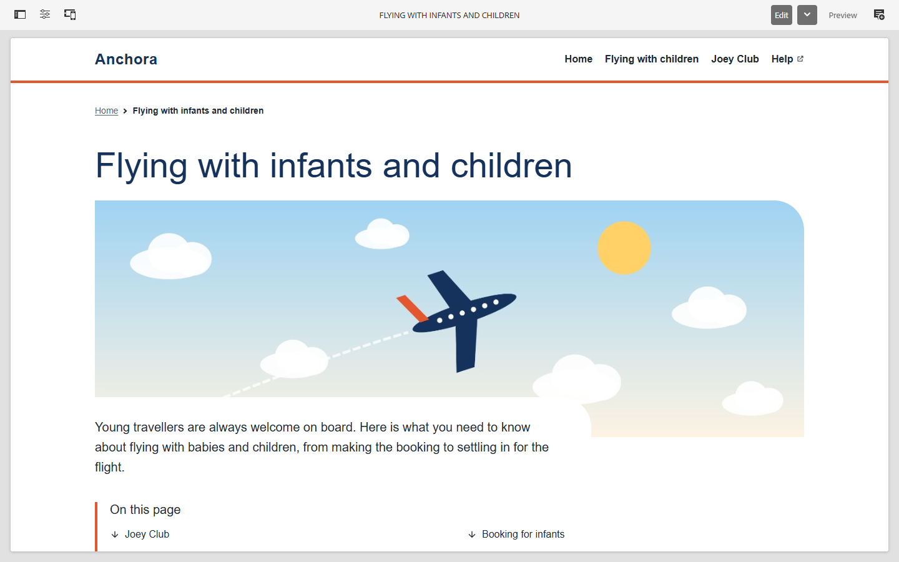

## Contents

1. [Where things live](#where-things-live)
2. [Creating the page](#creating-the-page)
3. [Authoring each component](#authoring-each-component)
   - [Hero](#hero)
   - [Breadcrumb](#breadcrumb)
   - [Teaser](#teaser)
   - [Accordion](#accordion)
   - [Title and Text](#title-and-text)
4. [Images and alternative text](#images-and-alternative-text)
5. [Managing accordion items](#managing-accordion-items)
6. [Header and footer](#header-and-footer)
7. [Previewing and publishing](#previewing-and-publishing)
8. [If something doesn't look right](#if-something-doesnt-look-right)

## Where things live

| What | Where in AEM |
|---|---|
| Pages | **Sites** › Anchora › us › en |
| The example page | **Sites** › Anchora › us › en › Flying with infants and children |
| Header and footer | **Experience Fragments** › Anchora › us › en › site › header / footer |
| Images | **Assets** › Files › anchora › flying-with-children |
| Page template | **Tools** › General › Templates › Anchora › Content Page (template authors only) |

## Creating the page

1. Go to **Sites** › **Anchora** › **us** › **en**.
2. Select **Create** › **Page**.
3. Choose the **Content Page** template, then select **Next**.
4. Enter a **Title**, for example "Flying with infants and children". The **Name** becomes the web address; if you leave it empty, AEM makes one from the title.
5. Select **Create**, then **Open**.

The new page already has the site header and footer. Between them is one empty content area that says **Drag components here**.

### What the template allows

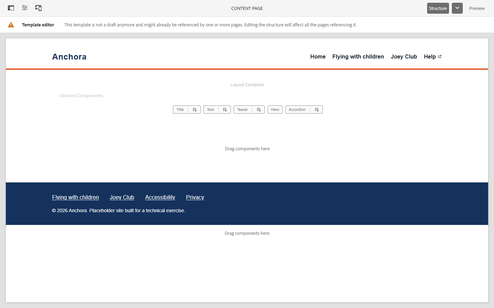

| Part of the page | Can you change it on the page? |
|---|---|
| Header | **No.** It is locked. It comes from the header experience fragment, see [Header and footer](#header-and-footer). |
| Breadcrumb | **Its settings only.** It is always there and builds itself from the page's place in the site, see [Breadcrumb](#breadcrumb). |
| Content area | **Yes.** You can add **Hero**, **Teaser**, **Accordion**, **Title** and **Text**. Other components aren't available here. |
| Footer | **No.** It is locked. It comes from the footer experience fragment. |

To add a component, open the side panel, go to the **Components** tab and drag one into the content area. You can also select **Drag components here**, then the **+** (Insert component) icon. The site's own components are in the **Anchora - Content** group.

A typical page follows the same order as the example:

1. **Hero** at the top: the page heading, a short introduction, an image and "On this page" links.
2. One or more **Teasers**, each pointing to a related page.
3. An **Accordion** for questions and answers.
4. **Title** and **Text** for anything else.

Each page should have only one Hero, because the Hero title is the page's main heading (H1).

## Authoring each component

To edit a component, select it and choose the wrench icon (**Configure**). Fields marked with an asterisk (*) are required.

### Hero

The large banner at the top of the page: the page heading, then a wide image with a large rounded top-right corner, then the introduction on a white panel that overlaps the bottom-left of the image, then the "On this page" links. Until you give it a title, it shows as an empty "Hero" box in the editor and doesn't appear on the published page.

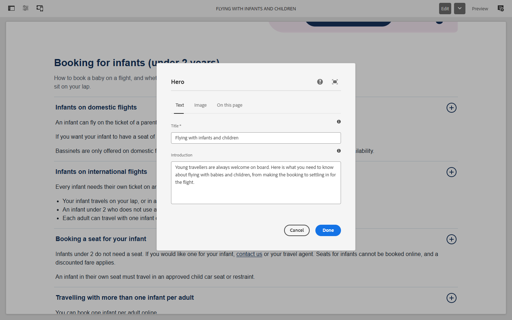

| Tab | Field | What it does |
|---|---|---|
| Text | **Title*** | The page heading. It's the only H1 on the page, so make it match what the page is about. Keep it short, for example "Flying with infants and children". |
| Text | **Introduction** | One or two sentences under the image that say what the page covers. Plain text only. |
| Image | **Image** | Drag an image in from the **Assets** tab of the side panel. Use a wide image (about **3:1**) at least **2400 pixels wide**. It fills the full width of the page content. Phones show a narrower slice (2:1), so they cut off the left and right edges, and the introduction covers part of the bottom-left corner. Keep the subject in the middle. Without an image, the introduction sits straight under the title. |
| Image | **Alternative text** | A description of the image for people who can't see it. It isn't shown on the page: screen readers read it out, and you can check it with the browser's **Inspect** (the `alt` of the image). If you leave it empty, AEM uses the **Description** from the image's metadata in Assets. See [Images and alternative text](#images-and-alternative-text). |
| Image | **Image is decorative** | Tick this if the image is only for decoration. Screen readers then skip it. While it is ticked, the **Alternative text** field is hidden and its text is ignored. |
| On this page | **Heading** | The heading above the jump links, which screen readers also announce as the name of the link list. Leave it empty to use "On this page". |
| On this page | **Jump links** | A short list of links to sections further down the page. Select **Add** for each link. Drag the handle to change the order. On tablets and larger screens the links are shown in two columns, filled top to bottom. |
| On this page | › **Label** | The link text, for example "Joey Club". |
| On this page | › **Anchor** | The **ID** of the section to jump to, for example `joey-club`. You can type it with or without `#`, and spaces become hyphens. The ID is set on the Teaser (**Anchor ID**) or the Accordion (**Properties** › **ID**). A link with a missing label or anchor isn't shown. |

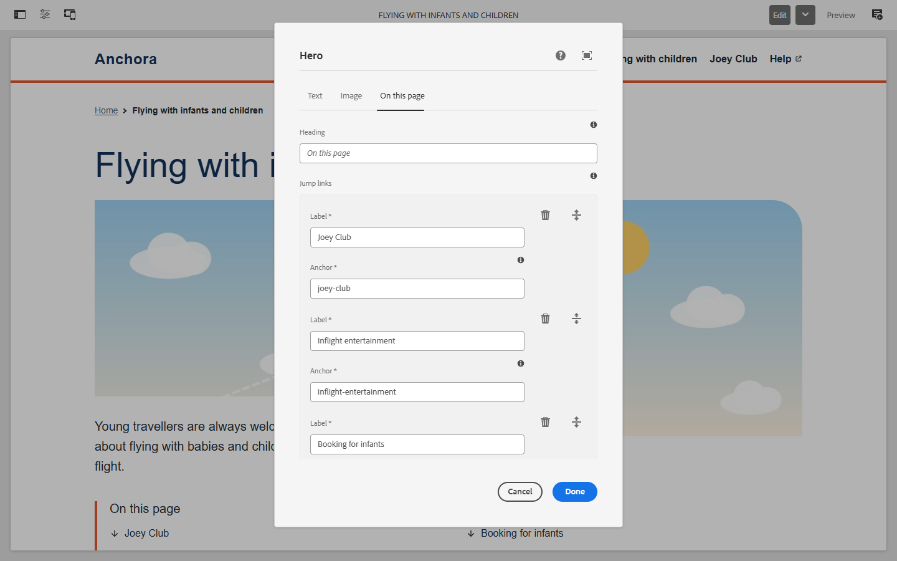

### Breadcrumb

The trail of links above the Hero, for example "Home › Flying with infants and children". It is part of the template, so every new page has it and you can't delete or move it. It builds itself from where the page sits under **Sites** › Anchora › us › en, so moving a page changes its breadcrumb.

- Each step shows the page's **Navigation Title** (Page Properties › Basic), or its title if that is empty. The site's top page has the Navigation Title "Home".
- The last step is the current page. It isn't a link.
- The Home page itself shows no breadcrumb, because its breadcrumb has **Hide current page** ticked.

You normally don't need to edit it. If you do, select it and choose **Configure**:

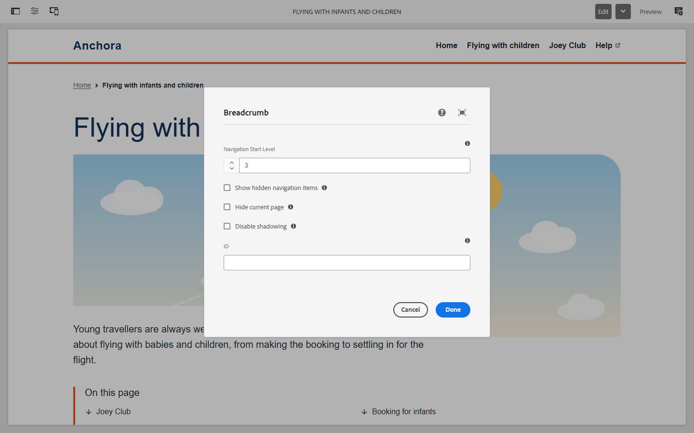

| Field | What it does |
|---|---|
| **Navigation Start Level** | Where the trail starts. Leave it at **3**, which is the Home page. A lower number adds site levels above Home that visitors don't need. |
| **Show hidden navigation items** | Also show pages that have **Hide in Navigation** ticked in their Page Properties. |
| **Hide current page** | Leave out the current page at the end of the trail. |

### Teaser

A card with a heading, an optional subtitle, a short description, an optional image and a link to another page. On the example page, one teaser promotes the Joey Club (image on the left) and another promotes inflight entertainment (image on the right).

On tablets and larger screens the image and the text sit side by side. On phones the image is always above the text, whichever side you pick.

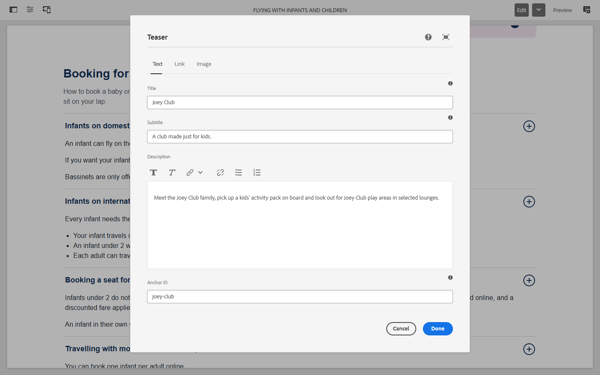

| Tab | Field | What it does |
|---|---|---|
| Text | **Title** | The card heading. You can't choose the heading level. The template sets it (H2 on this site), so headings stay in the right order. |
| Text | **Subtitle** | Optional. One short line under the title, for example "A club made just for kids.". Plain text only. |
| Text | **Description** | The card text. You can use bold, italic, links, and bulleted or numbered lists. Keep it to a short paragraph. |
| Text | **Anchor ID** | Optional. A short ID so a Hero jump link can point to this card, for example `joey-club`. It isn't shown on the page; it becomes the card's `id`, so `…/page.html#joey-club` scrolls to it. Use lower-case letters, numbers and hyphens, and don't reuse an ID on the same page. Spaces are turned into hyphens ("Find out" becomes `Find-out`), because an ID can't contain spaces. |
| Link | **Link target** | Pick a page on this site, or type a full web address starting with `https://`. |
| Link | **Link label** | The link text. Say where the link goes, for example "Find out about the Joey Club", not "Click here". **The link isn't shown while this is empty.** |
| Link | **Open in a new tab** | Use only for other websites. Screen readers announce "(opens in a new tab)" for these links. |
| Link | **Show a "Back to top" link under the teaser** | Adds a small "↑ Back to top" link below the image and text that takes readers back to the top of the page. Use it on long pages, for example at the end of each section. |
| Link | **Back to top label** | Optional. Leave it blank to use "Back to top". Only shown when the box above is ticked. |
| Image | **Image**, **Alternative text**, **Image is decorative** | As for the Hero. Use an image at least **1280 pixels wide**. The whole image is shown, never cropped. |
| Image | **Image position** | **Left** (the default) or **Right**: which side of the text the image goes on, on tablets and larger screens. To alternate cards down a page, set every second teaser to **Right**. |

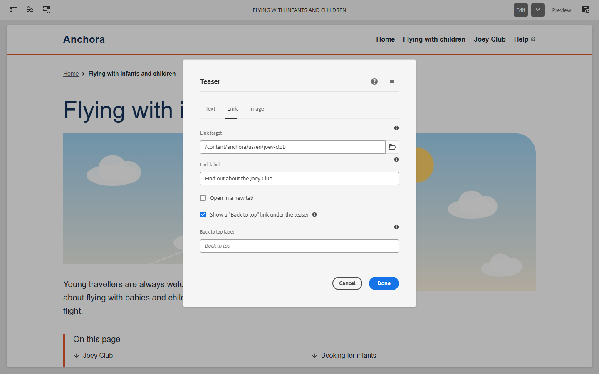

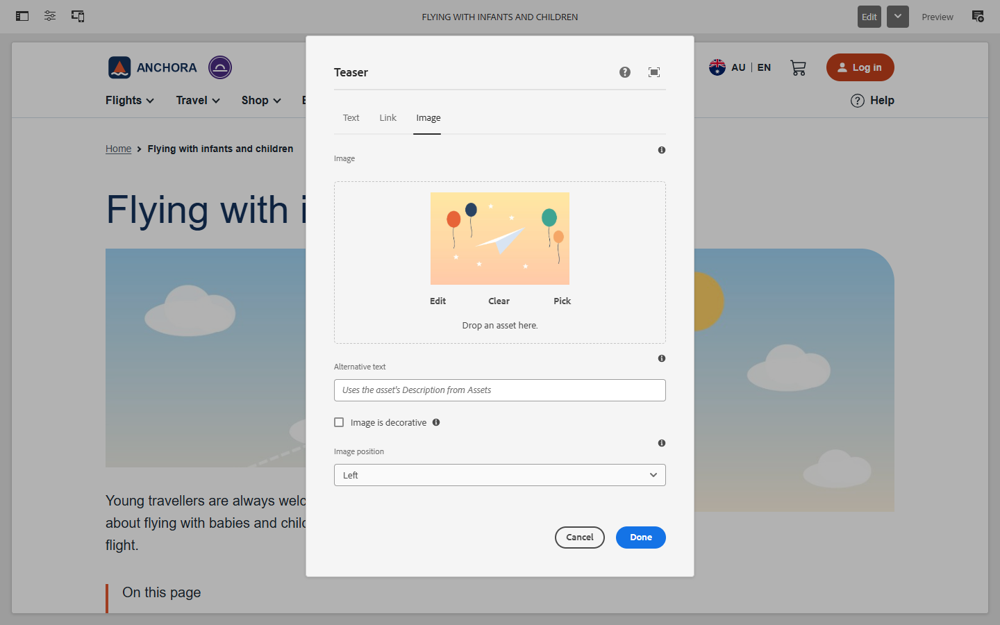

A teaser without a title, subtitle, description or image doesn't appear on the published page.

### Accordion

A section heading and introduction, followed by a list of items that open and close, like the "Booking for infants" questions on the example page. All items start closed when someone opens the page. Your readers can open them by clicking or with the keyboard, or open them all at once with the **Expand all items** button above the list. On a desktop, the heading and introduction sit on the left and the items on the right; on a phone, the items follow the introduction.

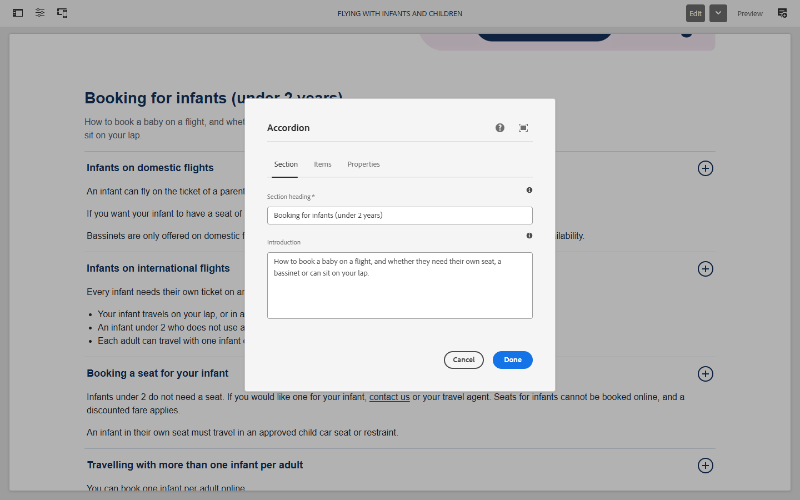

| Tab | Field | What it does |
|---|---|---|
| Section | **Section heading*** | The heading above the items (an H2), for example "Booking for infants (under 2 years)". |
| Section | **Introduction** | Optional. A short paragraph under the heading. |
| Section | **Expand all label** | Optional. The text of the button that opens every item. Leave it empty to show "Expand all items". |
| Section | **Collapse all label** | Optional. The button's text once every item is open. Leave it empty to show "Collapse all items". |
| Items | (list of items) | The item titles. The answers and their links aren't edited here: select an answer on the page and choose **Configure** › **Links**. See [Managing accordion items](#managing-accordion-items). |
| Properties | **Single item expansion** | Tick this if only one item should be open at a time. Opening an item then closes the one that was open. Leave it unticked to let readers open several items. The **Expand all items** button only appears when this is unticked and there are at least two items. |
| Properties | **Heading element** | Fixed at H3 so that item titles sit correctly under the section heading. |
| Properties | **ID** | Optional. A short ID so a Hero jump link can point to this section, for example `booking-for-infants`. |

**Grey background.** To put the section on a light grey band that runs the full width of the page, as on the example page, select the accordion, choose the paintbrush (**Styles**) in its toolbar and pick **Background › Tinted background**. Choose it again to remove it.

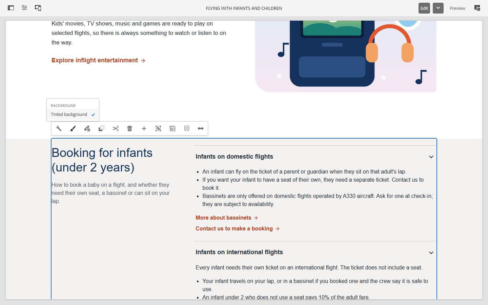

### Title and Text

These are the standard AEM Title and Text components.

- **Title** – a heading for an extra section. You can pick H2 to H6. H1 isn't offered, because the Hero title is the page's only H1. Choose the level that fits the outline: H2 for a new section, H3 for a part of that section.
- **Text** – paragraphs, with bold, italic, bulleted and numbered lists, and links. You can also format a paragraph as a quote or preformatted text.

## Images and alternative text

**Sizes**

| Component | Shape | Minimum width |
|---|---|---|
| Hero | Wide (about 3:1), subject in the middle | 2400 pixels |
| Teaser | Landscape (about 3:2) | 1280 pixels |

Upload images to **Assets** › anchora › flying-with-children (or a folder next to it), then drag them from the side panel's Assets tab into the dialog. AEM automatically serves smaller copies to phones.

**Writing alternative text**

- Describe what the image shows that matters on this page, in one short sentence (ideally under 125 characters). For example: "A parent holding a sleeping baby on a plane".
- Don't start with "Image of" or "Picture of"; screen readers already say it's an image.
- Don't repeat the heading or text next to the image.
- If the image adds no information, tick **Image is decorative** instead of writing alternative text.
- To use the same text everywhere an image appears, fill in **Description** in the image's properties in Assets and leave **Alternative text** empty in the dialog. Text typed in the dialog always takes priority.

## Managing accordion items

Each accordion item is a title plus an **Accordion item** component that holds the answer: rich text, followed by optional links with an arrow (for example, "More about bassinets"). In **Edit** mode, every item is shown open so you can see and edit all the answers, and the **Expand all items** button is hidden. In **Preview** mode and on the live site, items start closed.

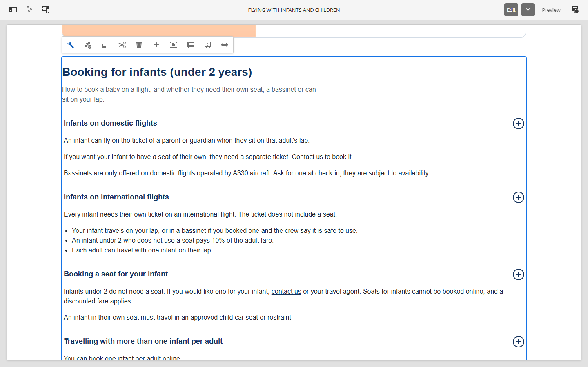

| To | Do this |
|---|---|
| **Add an item** | Select the accordion › **Configure** (wrench) › **Items** tab › **Add**. If AEM asks which component to use, choose **Accordion item** (the only component allowed in an item). Type the item title and select **Done** (✓). The new item appears at the end with an empty answer. Then write its answer as described below. |
| **Edit an item's title** | Change the title in the **Items** tab, then select **Done**. |
| **Edit an item's answer** | Select the answer text on the page. Use **Edit** (pencil) to type directly on the page, or **Configure** (wrench) to open the full text editor shown below. Double-clicking the answer also opens the full editor. |
| **Add links under an answer** | Select the answer › **Configure** (wrench) › **Links** tab › **Add**. Fill in the **Label** (the words people click) and the **Link** (choose a page, or paste a web address), and tick **Open in a new tab** for other websites. Drag the handle (⋮⋮) to reorder the links. A link with no label or no target isn't shown. |
| **Reorder items** | In the **Items** tab, drag an item by its handle (⋮⋮), then select **Done**. You can also select the accordion, choose **Select panel** in its toolbar, and drag items in the list that opens. |
| **Remove an item** | In the **Items** tab, select the bin icon next to the item, then **Done**. This also deletes the item's answer and links, so copy the text first if you might need it again. |
| **Go to an item** | Select the accordion › **Select panel** › choose the item. The editor scrolls to it and selects it. |

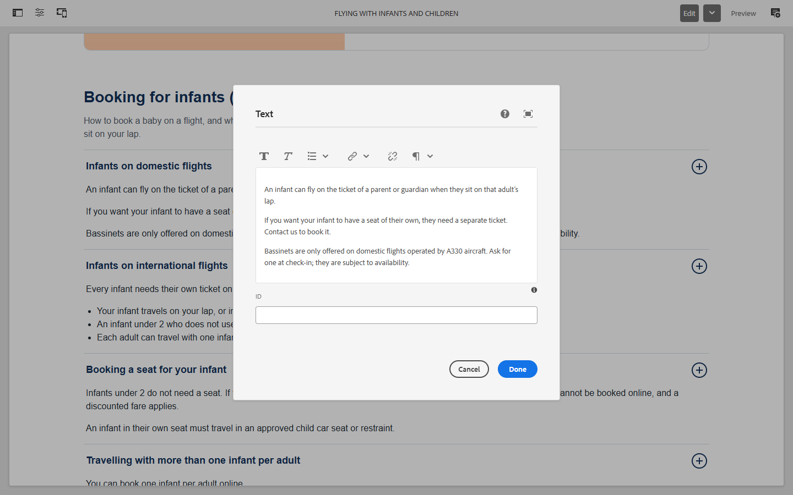

Keep item titles as short questions or statements, such as "Infants on domestic flights", and put the detail in the answer. Use the **Links** tab for "read more" links rather than typing them into the text, so they get the arrow and stay in the same place under every answer.

## Header and footer

The header (logo, partner badge, region, cart, log in, dropdown menus and Help) and footer (back to top, logo, link columns, social links, legal links and acknowledgement) are **experience fragments**. They are shared by every page made from the Content Page template. You can't change them from a page.

**To edit them:**

1. Go to **Experience Fragments** › **Anchora** › **us** › **en** › **site**.
2. Open **header** or **footer**, then open its **master** variation.
3. Select the Header or Footer component and choose **Configure** (wrench).

**Header fields**

The header dialog has three tabs. Every part of the header is hidden when its fields are empty.

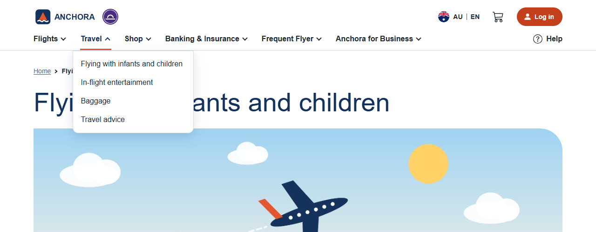

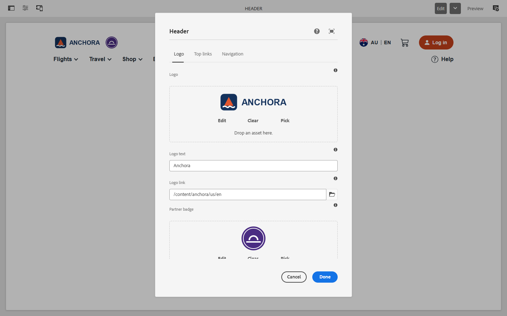

*Logo*

| Field | What it does |
|---|---|
| **Logo** | Drag the logo from the Assets panel. It's shown 40 pixels high (32 on phones). Without a logo, the **Logo text** is shown instead. |
| **Logo text** | The brand name. Screen readers read it out as the logo. Defaults to "Anchora". |
| **Logo link** | Usually the home page. Leave it blank for a logo without a link. |
| **Partner badge** | Optional. A round badge next to the logo, such as an alliance membership. |
| **Partner badge alternative text** | What the badge says, for screen readers, for example "Member of Horizon Alliance". Leave it blank to use the image's **Description** in Assets. |

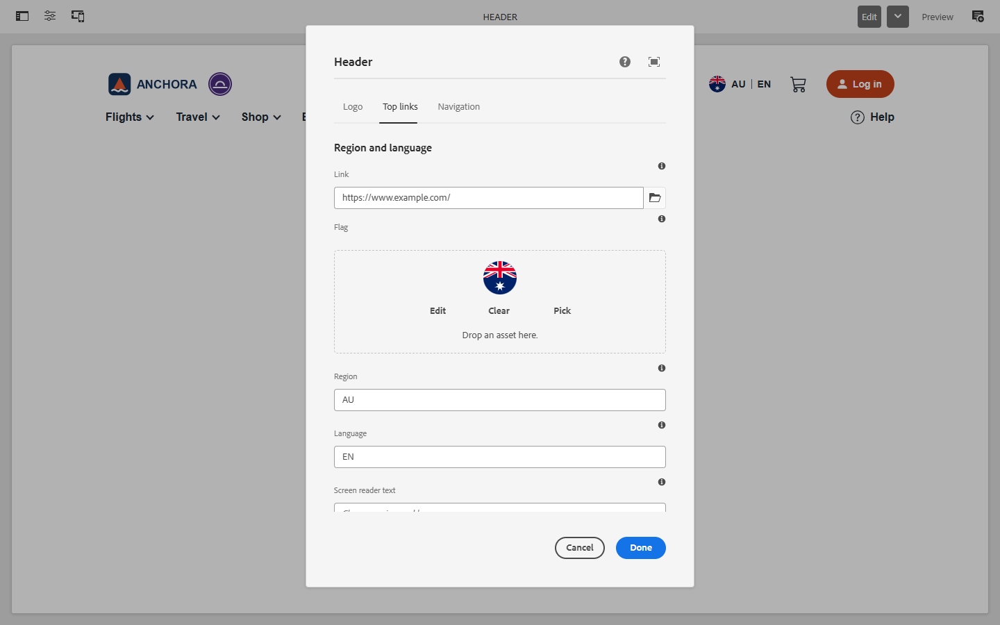

*Top links*

| Field | What it does |
|---|---|
| **Region and language: Link** | The page where readers choose their region and language. Leave it blank to hide the flag and codes. |
| **Flag** | Optional. A round flag shown before the region code. Screen readers skip it, because the code says the same. |
| **Region**, **Language** | Short codes shown as "AU \| EN". |
| **Screen reader text (not shown on the page)** | Hidden text that says what the region link does. Only screen readers read it out, so you won't see it on the page. Defaults to "Change region and language". |
| **Cart: Link** | Shows the cart icon. Leave it blank to hide the icon. |
| **Cart: Screen reader text (not shown on the page)** | The icon has no visible text, so screen readers read this instead. Defaults to "Cart". |
| **Log in button: Link**, **Label** | The red button at the top right. Leave the link blank to hide it. The label defaults to "Log in". On phones only the person icon shows. |

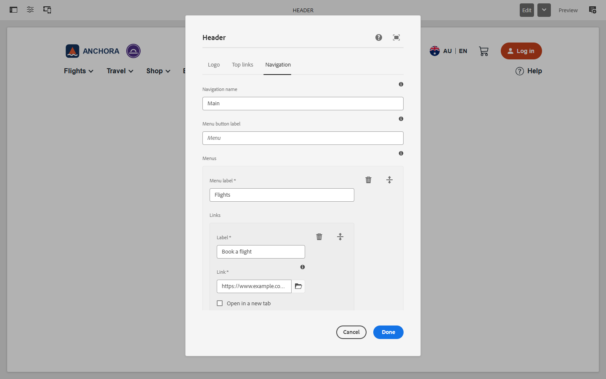

*Navigation*

| Field | What it does |
|---|---|
| **Navigation name (screen readers only)** | A name that screen readers announce for the menus, for example "Main". It isn't shown on the page. Defaults to "Main". |
| **Menu button label (phones and tablets)** | The button that shows the menus on screens narrower than 1024 pixels. Desktops always show the menus, so the button is hidden there. Defaults to "Menu". |
| **Menus** | Choose **Add** for each menu. Give it a **Menu label***, then add its **Links**: **Label***, **Link*** and **Open in a new tab**. Six short menus fit on one row on a desktop. Drag the handles to reorder menus or links. |
| **Help link**, **Help label** | Shown with a question-mark icon at the right end of the first menu row. Leave the link blank to hide it. The label defaults to "Help". A long label never wraps or drops to the next row; instead, the last menus move to a second row. |

On phones and tablets, the menus are behind the **Menu** button and open one below the other:

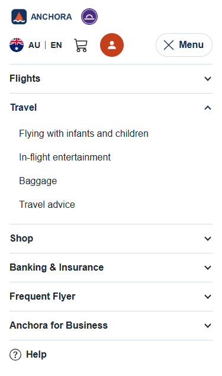

**Footer fields**

The footer dialog has four tabs. Every part of the footer is hidden when its fields are empty.

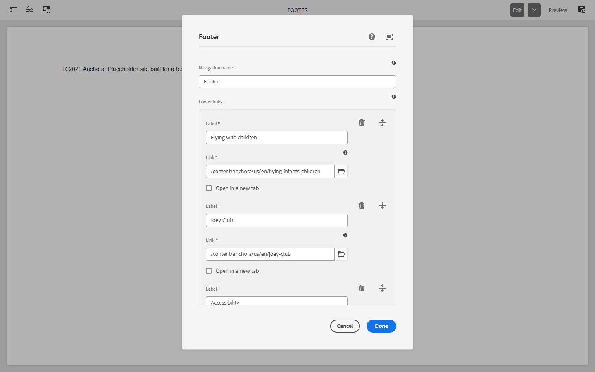

*General*

| Field | What it does |
|---|---|
| **Show a "Back to top" link** | Adds "↑ Back to top" at the top right of the footer. |
| **Back to top label** | The link text. Defaults to "Back to top". |
| **Logo** | Drag the logo from the Assets panel. It's shown 40 pixels high. Without a logo, the **Logo text** is shown instead. |
| **Logo text** | The brand name. Screen readers read it out as the logo. Defaults to "Anchora". |
| **Logo link** | Usually the home page. Leave it blank for a logo without a link. |

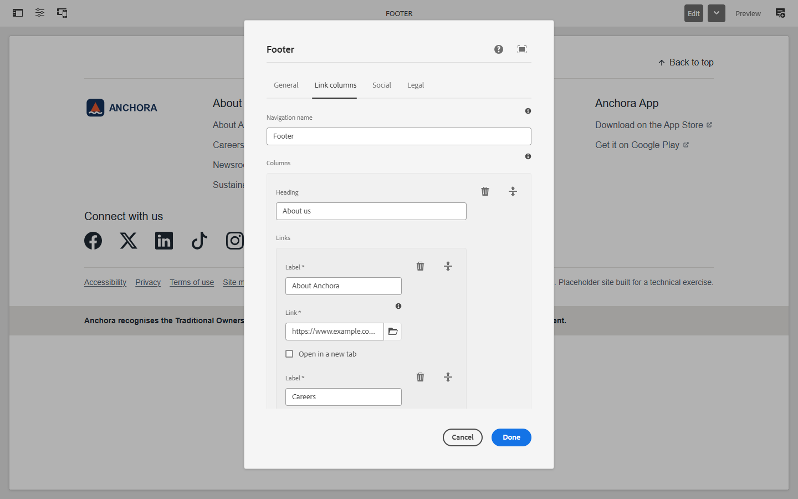

*Link columns*

| Field | What it does |
|---|---|
| **Navigation name** | A name that screen readers announce for the footer links. Defaults to "Footer". |
| **Columns** | Choose **Add** for each column. Give it a **Heading**, then add its **Links**: **Label***, **Link*** and **Open in a new tab**. Four columns fit next to the logo on a desktop; phones show two side by side. Drag the handles to reorder columns or links. |

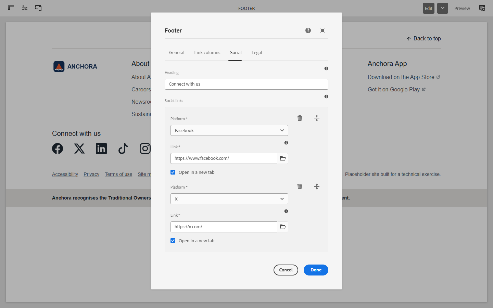

*Social*

| Field | What it does |
|---|---|
| **Heading** | Shown above the icons. Defaults to "Connect with us". |
| **Social links** | For each: **Platform*** (Facebook, X, LinkedIn, TikTok, Instagram or YouTube), **Link*** (the full address of the profile) and **Open in a new tab**. The platform chooses the icon, and screen readers announce the platform name. |

*Legal*

| Field | What it does |
|---|---|
| **Legal links** | Small underlined links at the bottom, such as Privacy and Terms of use. For each: **Label***, **Link*** and **Open in a new tab**. |
| **Copyright line** | Write `{year}` where the current year should appear, for example `© {year} Anchora. All rights reserved.` The year updates itself every January. |
| **Acknowledgement** | Optional. Shown in a darker band across the bottom of the footer, for example an Acknowledgement of Country. |

**What changes when you edit them**

- On the author instance, your change appears straight away on **every** page that uses the template.
- On the live site, nothing changes until you **publish the experience fragment**. Publishing a page doesn't republish the header or footer.

## Previewing and publishing

### Preview on the author instance

- In the page editor, switch the mode selector (top right) from **Edit** to **Preview**. Links and accordion items now behave as they do on the live site.
- To see the page without the editor, open **Page Information** (the icon at the top left) › **View as Published**. This opens the page with `?wcmmode=disabled` at the end of the address.
- To check phone and tablet sizes, use the **Emulator** button in the editor toolbar, or make your browser window narrower in **View as Published**.

### Publish

> **Note:** No publish instance was set up for this exercise. The page, header and footer were only previewed on the local author instance. The steps below are the standard AEM as a Cloud Service steps; they were not tested on this project.

1. In **Sites**, select the page.
2. Choose one of the following:
   - **Quick Publish** – publishes the page straight away.
   - **Manage Publication** – lets you choose **Publish** or **Preview** (AEM as a Cloud Service's preview service, useful for review before going live), schedule a date and time, and check the page's **references**.
3. The first time you publish, make sure the following are published too (Manage Publication lists them as references):
   - the images the page uses;
   - the **header** and **footer** experience fragments, and their images (logo, partner badge and flag);
   - the template and its policies (normally done once by a developer or template author).
4. To take a page down, use **Manage Publication** › **Unpublish**.

Changes you make to the page later are only visible on the live site after you publish it again. Changes to the header or footer need the experience fragment to be published (see above).

## If something doesn't look right

| Problem | What to check |
|---|---|
| The teaser link is missing | Fill in **Link label** as well as **Link target**. |
| A teaser has no "Back to top" link | Tick **Show a "Back to top" link under the teaser** on the **Link** tab. A label on its own doesn't show the link. |
| A teaser image is above the text even though **Image position** is **Right** | That's expected on phones and narrow windows. The image moves to the side from tablet width up. |
| A jump link doesn't scroll anywhere | The **Anchor** must exactly match the Teaser's **Anchor ID** or the Accordion's **ID** (without the `#`). Spaces become hyphens in both, so "Find out" matches `Find-out`. |
| The Hero doesn't show on the published page | Give it a **Title**. |
| The edges of the Hero image are cut off on a phone | That's expected: phones show the middle of the image. Choose an image with the subject in the middle. |
| The breadcrumb shows the wrong title for a page | Change the page's **Navigation Title** in Page Properties. |
| An image has no description for screen readers | Fill in **Alternative text**, or the image's **Description** in Assets, or tick **Image is decorative**. |
| I typed **Alternative text** but can't see it on the page | That's expected: only screen readers read it out. Check it with the browser's **Inspect** (the image's `alt`). If it is still empty there, untick **Image is decorative**. |
| The **Alternative text** field has disappeared from the dialog | **Image is decorative** is ticked. Untick it to show the field again. |
| An accordion answer has no **Links** tab | The item was added before the Accordion item component existed, or as a plain Text component. Remove the item and add it again from the **Items** tab, choosing **Accordion item**. |
| The region's screen reader text or the navigation name isn't on the page | That's expected: both are only read out by screen readers. |
| The **Menu** button is missing on a desktop | That's expected: it only appears on screens narrower than 1024 pixels. |
| Accordion items are all open in the editor | That's expected in Edit mode. Switch to **Preview** to see them closed. |
| The **Expand all items** button is missing | That's expected in Edit mode, when **Single item expansion** is ticked, and when the accordion has only one item. |
| The accordion's grey band is missing | Choose **Background › Tinted background** in the accordion's **Styles** (paintbrush) menu. |
| A link under an accordion answer is missing | Give it both a **Label** and a **Link** on the answer's **Links** tab. |
| A header or footer change isn't live | Publish the experience fragment. |
| A header menu is missing | Give it a **Menu label** and at least one link. A link needs both a **Label** and a **Link**. |
| The flag, cart, log in button or Help is missing from the header | Fill in its **Link**. Each one is hidden when its link is empty. |
| The header menus wrap onto two rows on a desktop | Shorten the menu labels, the **Help label**, or use fewer menus. Six short menus and Help fit on one row. Help always stays at the right end of the first row. |
| A footer column is missing | Give it a **Heading** or at least one link. A link needs both a **Label** and a **Link**. |
| A social icon is missing | Choose a **Platform** and fill in the **Link**. |
| The footer shows the logo text instead of the logo | Choose an image in **Logo** on the **General** tab. On the live site, also publish the image. |
| A link to another website has disappeared from the published page | AEM hides links to addresses that return an error. Check that the web address works in a browser. |
