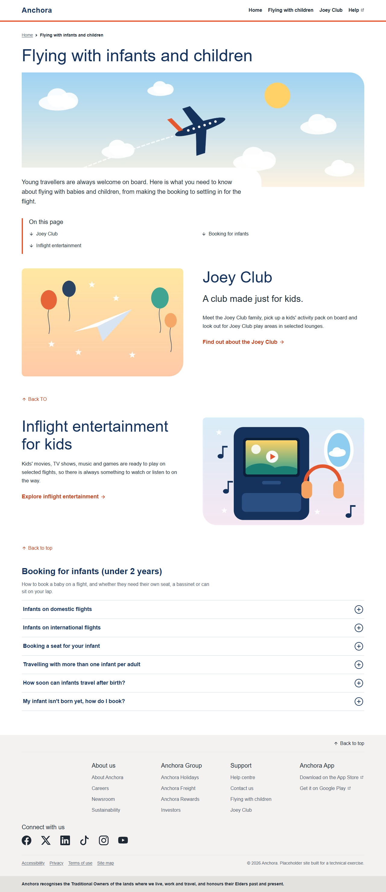
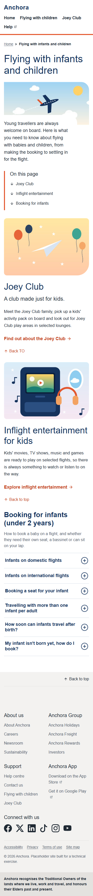

# Anchora – "Flying with infants and children"

This repository rebuilds the [Qantas "Flying with infants and children"](https://www.qantas.com/en-au/travel-information/flying-infants-children) page on AEM as a Cloud Service (AEMaaCS). It was built for the Anchora Full Stack Engineer technical exercise. The page uses three authorable components (Hero, Teaser and Accordion) on an editable template with a locked header and footer. All the copy is paraphrased, and the images are simple illustrations made for this exercise.

| Guide | For |
|---|---|
| **README.md** (this file) | Developers: set-up, structure, components, decisions, tests, requirement trace |
| [AUTHORING.md](AUTHORING.md) | Content authors: creating and editing the page |
| [AI_NOTES.md](AI_NOTES.md) | How AI tools were used |
| [.github/copilot-instructions.md](.github/copilot-instructions.md) | The project rules given to the AI assistant |

| Desktop (1280 px) | Mobile (375 px) |
|---|---|
|  |  |

## Contents

1. [Prerequisites](#prerequisites)
2. [Set-up and deploy](#set-up-and-deploy)
3. [Archetype](#archetype)
4. [Project structure](#project-structure)
5. [Component reference](#component-reference)
6. [Design decisions](#design-decisions)
7. [Testing](#testing)
8. [Requirement trace](#requirement-trace)
9. [Assumptions, known limitations and next steps](#assumptions-known-limitations-and-next-steps)
10. [Open-source libraries and licences](#open-source-libraries-and-licences)

## Prerequisites

| Tool | Version used | Notes |
|---|---|---|
| Java | OpenJDK **21.0.13** for the Maven build | Matches `.cloudmanager/java-version` (21). The local SDK itself ran on Java 17.0.12. |
| Maven | **3.9.10** | Any Maven 3.9.x should work. |
| Node.js | **v24.21.0** (LTS) and the npm that ships with it | You don't need to install these yourself. The Maven build downloads them into `ui.frontend/node` with `frontend-maven-plugin` (set in the root `pom.xml`). You only need your own Node 24 if you run `npm` scripts directly. |
| AEM SDK | **2025.4.20476.20250414T214138Z-250300** (`aem-sdk-quickstart-…jar`) | Author service on `localhost:4502`, user `admin`/`admin`. No publish instance was set up. |
| Git | any recent version | |

`aem.sdk.api` in the root `pom.xml` is pinned to the same SDK version, `2025.4.20476.20250414T214138Z-250300`. The archetype's `sdkVersion=latest` compiled against a newer API than the local SDK provides, so the `anchora.core` bundle would not resolve. An older API always works on a newer SDK. If you run a newer SDK, you can leave the pin or raise it to match.

## Set-up and deploy

1. **Start a local AEM author.** Download the AEMaaCS SDK from Adobe's Software Distribution portal. Start the quickstart as an author on port 4502 (for example, rename it to `aem-author-p4502.jar` and run `java -jar aem-author-p4502.jar`). Wait until <http://localhost:4502> shows the login page.
2. **Clone the repository.**

   ```shell
   git clone https://github.com/patelsidd1/Anchora.git
   cd Anchora
   ```

3. **Build and deploy** (EN-02):

   ```shell
   mvn clean install -PautoInstallSinglePackage
   ```

   This single command does the following:
   - compiles the `core` bundle and runs its 50 unit tests (the build stops if one fails);
   - downloads Node and runs `npm ci` and the webpack production build in `ui.frontend`, then copies the client libraries into `ui.apps`;
   - packages everything into `all/target/anchora.all-1.0.0-SNAPSHOT.zip` and installs it on `localhost:4502` as `admin`/`admin`.

   For another host or other credentials, add `-Daem.host=… -Daem.port=… -Dvault.user=… -Dvault.password=…`.
4. **Open the page.**

   | What | URL |
   |---|---|
   | Page in the editor | <http://localhost:4502/editor.html/content/anchora/us/en/flying-infants-children.html> |
   | Page as published (no editor) | <http://localhost:4502/content/anchora/us/en/flying-infants-children.html?wcmmode=disabled> |
   | Joey Club placeholder page | <http://localhost:4502/editor.html/content/anchora/us/en/joey-club.html> |
   | Inflight entertainment placeholder page | <http://localhost:4502/editor.html/content/anchora/us/en/inflight-entertainment.html> |
   | Header experience fragment | <http://localhost:4502/editor.html/content/experience-fragments/anchora/us/en/site/header/master.html> |
   | Footer experience fragment | <http://localhost:4502/editor.html/content/experience-fragments/anchora/us/en/site/footer/master.html> |
   | Template structure | <http://localhost:4502/editor.html/conf/anchora/settings/wcm/templates/page-content/structure.html> |

**Faster loops while developing**

| Change | Command |
|---|---|
| Java only | `mvn -pl core install -PautoInstallBundle` |
| HTL, dialogs or clientlibs | `mvn -pl ui.frontend,ui.apps install -PautoInstallPackage` |
| Content, template or policies | `mvn -pl ui.content install -PautoInstallPackage` (see the note below) |

**Re-deploying content.** The `ui.content` filters use `mode="merge"`. A redeploy adds missing nodes, but it never overwrites content that is already on the instance, so author edits are safe. To reset the page, header, footer or template to the shipped version, delete it in AEM first and then redeploy. Merge also skips new child nodes written inside a `.content.xml` whose node already exists (for example, a new policy in `conf/anchora/settings/wcm/policies/.content.xml`, or a new component on a page). In that case, delete the node that owns the file (the whole page, or the whole `policies` node), not only its `jcr:content`.

**Troubleshooting**

- *`mvn clean` fails on Windows with "Failed to delete … ui.apps\target".* An IDE (for example, VS Code's Java extension) is holding a lock on the folder. Close the IDE, or run the same command without `clean`.
- *The page shows Core Components errors, and the Bundles console lists two active `com.adobe.cq.core.wcm.components.core` bundles.* This happens when another project on the same instance has installed an older Core Components bundle; on my machine it was 2.19 next to the SDK's 2.28. Stop the older bundle in `/system/console/bundles`, then refresh packages. It doesn't happen on a clean SDK.

## Archetype

The project was generated with the **AEM Project Archetype, version 58** (EN-01). The parameters are recorded in [`archetype.properties`](archetype.properties):

| Parameter | Value | Parameter | Value |
|---|---|---|---|
| `groupId` | `com.anchora.aem` | `includeDispatcherConfig` | `n` |
| `artifactId` | `anchora` | `includeCif` | `n` |
| `version` | `1.0.0-SNAPSHOT` | `includeForms` | `n` |
| `package` | `com.anchora.aem` | `includeFormsenrollment` | `n` |
| `appId` | `anchora` | `includeFormscommunications` | `n` |
| `appTitle` | `Anchora` | `includeFormsheadless` | `n` |
| `aemVersion` | `cloud` | `sdkFormsVersion` | `latest` |
| `sdkVersion` | `latest` (later pinned, see [Prerequisites](#prerequisites)) | `commerceEndpoint` | `https://hostname.com/graphql` |
| `language` / `country` | `en` / `us` | `datalayer` | `y` |
| `includeExamples` | `n` | `amp` | `n` |
| `includeErrorHandler` | `n` | `enableDynamicMedia` | `n` |
| `frontendModule` | `general` | `enableSSR` | `n` |
| `singleCountry` | `y` | `precompiledScripts` | `n` |
| | | `uiTestingFramework` | `cypress` |

`languageCountry` was supplied as an unresolved placeholder, so the archetype defaults (`en`, `us`) were used. That is why the site lives under `/content/anchora/us/en`.

## Project structure

Only the modules below were changed. `ui.apps.structure`, `ui.config`, `all`, `it.tests` and `ui.tests` are exactly as the archetype generated them.

| Module | What changed | Why |
|---|---|---|
| Root `pom.xml` | Pinned `aem.sdk.api`. Moved Node to v24.21.0 with its bundled npm. Removed the `junit-addons` test dependency. | Match the local SDK. Node 16 / npm 8 from the archetype are end of life. `junit-addons` was only used by the deleted sample tests. |
| `core` | Removed the sample servlet, filter, listener, scheduler and HelloWorld model (and their tests). Added the models in `com.anchora.aem.core.models` (interfaces), `…models.impl` (implementations and helpers), and their tests. | All rendering logic lives in Sling Models behind interfaces (HB-05). |
| `ui.apps` | Added `hero`, `teaser`, `header` and `footer`. Extended `accordion`. Added a favicon link to the page and XF page head. Removed `helloworld`. | The components the page needs (HB, TS, AC, PT). |
| `ui.content` | Template structure (including a Core breadcrumb) and policies. The Home, Flying with infants and children, Joey Club and Inflight entertainment pages. Header and footer experience fragments. Three DAM images and a placeholder logo (`/content/dam/anchora/brand`). Removed the sample asset. | The page ships with the code (EN-04), so a reviewer sees it after one install. |
| `ui.frontend` | Site variables, base styles (skip link, focus, visually-hidden text), and component SCSS. Removed unused sample styles and scripts. Fixed the `svgo` option in `webpack.prod.js`. | All CSS ships as the `anchora.site` client library (PT-06). No custom JavaScript is needed, because the accordion uses the Core Components script. |

Java code:

```
core/src/main/java/com/anchora/aem/core/models/
├── Hero.java, Teaser.java, SectionAccordion.java, Header.java, Footer.java   (model interfaces used by HTL)
├── LinkItem.java, ResponsiveImage.java, LinkGroup.java, SocialLink.java   (simple value objects)
└── impl/
    ├── HeroImpl, TeaserImpl, SectionAccordionImpl, HeaderImpl, FooterImpl  (Sling Models)
    ├── Links.java             link resolution: internal page → .html, new tab → target + rel
    └── ResponsiveImages.java  image helper: srcset from DAM renditions, alt text fallback, decorative flag
```

## Component reference

All components are in `ui.apps/src/main/content/jcr_root/apps/anchora/components/`. Every Sling Model adapts from `SlingHttpServletRequest`, and its HTL only reads getters.

**Client libraries**

| Category | Contents | Loaded by |
|---|---|---|
| `anchora.site` | All site and component CSS, built from `ui.frontend` | Page policy (`clientlibs`) |
| `anchora.dependencies` | Archetype runtime dependencies (JS, in the head) | Page policy (`clientlibsJsHead`) |
| `anchora.base` | Embeds Core Components clientlibs, including `core.wcm.components.accordion.v1` (accordion JS and keyboard support), and the grid | `page/customheaderlibs.html`, `page/customfooterlibs.html` |

### Hero – `anchora/components/hero`

| | |
|---|---|
| Build | Custom; no supertype |
| Group | Anchora - Content |
| Sling Model | `Hero` → `HeroImpl` (uses `ResponsiveImages`) |
| Dialog | **Text**: Title (`./jcr:title`, required), Introduction (`./intro`). **Image**: Image (`./fileReference`, dragged from Assets), Alternative text (`./alt`), Image is decorative (`./isDecorative`). **On this page**: Heading (`./jumpLinksTitle`, default "On this page"), Jump links multifield (`./jumpLinks`) of Label (`./label`) and Anchor (`./anchor`). |
| Policy | None needed |
| Markup | `<h1>`, then the image (``), then the intro, then `<nav>` with the authored heading as its `aria-label` and `<h2>`, and a list of `#anchor` links. Shows the Core placeholder in the editor when there is no title (HB-06). The root gets `cmp-hero--with-image` or `cmp-hero--text-only`. |
| Layout | A wide image (2:1 on phones, 3:1 from 768 px, `object-fit: cover`) with a large rounded top-right corner. When there is an image, the intro sits on a white panel that overlaps its bottom-left corner. The jump links have an accent bar on the left, a down arrow before each link, and two columns from 768 px. The source image should be about 3:1 and at least 2400 px wide (see [AUTHORING.md](AUTHORING.md#hero)). |

### Teaser – `anchora/components/teaser`

| | |
|---|---|
| Build | Custom; no supertype (see [Design decisions](#design-decisions)) |
| Group | Anchora - Content |
| Sling Model | `Teaser` → `TeaserImpl` (uses `Links` and `ResponsiveImages`) |
| Dialog | **Text**: Title (`./jcr:title`), Subtitle (`./subtitle`, plain text), Description (`./description`, rich text: bold, italic, link, lists), Anchor ID (`./id`). **Link**: Link target (`./linkURL`, a page or an external URL), Link label (`./linkLabel`), Open in a new tab (`./linkNewTab`), Show a "Back to top" link (`./backToTop`), Back to top label (`./backToTopLabel`, default "Back to top"). **Image**: Image (`./fileReference`), Alternative text (`./alt`), Image is decorative (`./isDecorative`), Image position (`./imagePosition`: `left`, the default, or `right`). |
| Design dialog | Title heading level (`titleType`, H2–H6) |
| Policy | `anchora/components/teaser/policy_1575031387650` "Content Teaser": `titleType=h2` (TS-02) |
| Markup | Heading at the policy level (only H2–H6 are accepted; anything else falls back to H2), optional subtitle `<p>`, HTML description, link with an arrow icon, `rel="noopener noreferrer"` and visually hidden "(opens in a new tab)" text when opened in a new tab, and a lazy-loaded image. The root gets `cmp-teaser--image-left` or `cmp-teaser--image-right`. When ticked, a last `<a class="cmp-teaser__back-to-top" href="#top">` with an up-arrow icon. |
| Layout | Phones: image above the text. From 768 px: image and text side by side, and the image goes on the side the author chose. The image keeps its first place in the HTML; only CSS `order` moves it, and nothing in it can take focus, so the reading and tab order stay the same. The large rounded corner of the image always faces the text. The Back to top link spans the full width under both columns, left-aligned. |

### Accordion – `anchora/components/accordion`

| | |
|---|---|
| Build | **Extends Core Accordion v1** (`sling:resourceSuperType="core/wcm/components/accordion/v1/accordion"`) with the delegation pattern |
| Group | Anchora - Content |
| Sling Model | `SectionAccordion` (extends Core `Accordion`) → `SectionAccordionImpl`. It delegates to the Core model through `@Via(type = ResourceSuperType.class)` and adds `getSectionTitle()` and `getSectionIntro()`. `getExpandedItems()` always returns an empty array, so every item starts collapsed (AC-04). |
| Dialog | Overlay of the Core dialog through the Sling Resource Merger. New **Section** tab: Section heading (`./sectionTitle`, required), Introduction (`./sectionIntro`). Core **Items** tab: add, remove, reorder and rename items (`cq:panelTitle`). Core **Properties** tab: Single item expansion (`./singleExpansion`), Heading element, ID. The two "Expanded items" selects are hidden. |
| Other files | `accordion.html` (adapted from Core 2.28.0, Apache 2.0): renders the H2 section heading and intro, and `aria-expanded` on every button before the script runs. `_cq_template` starts a new accordion with a placeholder heading and two Text items. |
| Policy | `anchora/components/accordion/policy_accordion` "Content Accordion": items can only be `anchora/components/text`; `headingElement=h3`, `allowedHeadingElements=[h3]` |
| Behaviour | The Core `accordion.v1` script handles toggling and keyboard support (Enter, Space, arrow keys, Home, End). `_accordion.scss` shows every panel in the page editor (AC-06) and draws a `:focus-visible` outline. |

### Header – `anchora/components/header`

| | |
|---|---|
| Build | Custom; no supertype. Used only inside the header experience fragment. |
| Group | Anchora - Structure |
| Sling Model | `Header` → `HeaderImpl` |
| Dialog | Logo text (`./brandLabel`, default "Anchora"), Logo link (`./brandLink`), Navigation name (`./navLabel`, default "Main", becomes the `<nav>` `aria-label`), Navigation links multifield (`./links`: Label, Link, Open in a new tab). |
| Policy | The XF template's root container ("XF Root") allows only `header` and `footer`. On the page, the XF component uses the "Page Header" policy, which renders it as `<header>`. |

### Footer – `anchora/components/footer`

| | |
|---|---|
| Build | Custom; no supertype. Used only inside the footer experience fragment. |
| Group | Anchora - Structure |
| Sling Model | `Footer` → `FooterImpl` |
| Dialog | **General**: Show a "Back to top" link (`./backToTop`), Back to top label (`./backToTopLabel`, default "Back to top"), Logo (`./fileReference`), Logo text (`./brandLabel`, default "Anchora"; the logo's alt text, or shown as text when there is no logo), Logo link (`./brandLink`). **Link columns**: Navigation name (`./navLabel`, default "Footer"), Columns multifield (`./columns`: Heading, and a nested Links multifield with Label, Link, Open in a new tab). **Social**: Heading (`./socialTitle`, default "Connect with us"), Social links multifield (`./socialLinks`: Platform select, Link, Open in a new tab). **Legal**: Legal links multifield (`./links`), Copyright line (`./copyright`; `{year}` is replaced with the current year), Acknowledgement (`./acknowledgement`). |
| Markup | Back to top (`href="#top"`), then the logo and one `<nav>` holding the columns (each an `<h2>` and a list), then the social icons (an `<h2>` and a list; each link's name is the platform, in visually hidden text), then the legal links and copyright, then the acknowledgement in a full-width band. Each part is left out when it has no content. |
| Policy | "Page Footer" policy on the XF component, which renders it as `<footer>` |

### Core proxies used on the page

| Component | Supertype | Policy |
|---|---|---|
| `anchora/components/title` | `core/wcm/components/title/v3/title` | "Content Title": H2–H6, default H2. H1 is reserved for the hero. |
| `anchora/components/text` | `core/wcm/components/text/v2/text` | "Content Text": bold, italic, lists, links; paragraph, quote and preformatted formats |
| `anchora/components/breadcrumb` | `core/wcm/components/breadcrumb/v3/breadcrumb` | "Page Breadcrumb": `startLevel=3`, so the trail starts at Home (`/content/anchora/us/en`, Navigation Title "Home"). The Home page sets "Hide current page", so it shows no breadcrumb. |
| `anchora/components/container` | `core/wcm/components/container/v1/container` | "Page Root", "Page Main" (`<main id="main-content">`), "Page Content" (allowed components) |
| `anchora/components/experiencefragment` | `core/wcm/components/experiencefragment/v2/experiencefragment` | "Page Header" / "Page Footer" |
| `anchora/components/page` | `core/wcm/components/page/v3/page` | "Generic Page": clientlibs, and the skip link to `#main-content` (`mainContentSelector`) |

### Template – `/conf/anchora/settings/wcm/templates/page-content` ("Content Page")

```
root (container, locked)
├── experiencefragment-header   locked → /content/experience-fragments/anchora/us/en/site/header/master   <header>
├── container                   locked, <main id="main-content">
│   ├── breadcrumb              unlocked (can be configured per page), "Page Breadcrumb" policy
│   └── container               UNLOCKED "Page Content": hero, teaser, accordion, title, text
└── experiencefragment-footer   locked → /content/experience-fragments/anchora/us/en/site/footer/master   <footer>
```

## Design decisions

| Component | Choice | Reason |
|---|---|---|
| Hero | **Custom** | Core has no hero. Making a Core Teaser behave like a hero (H1, jump-link list, DAM alt fallback) would take more overrides than a small model does. |
| Teaser | **Custom, built from scratch** (TS-04) | The brief needs a narrow set of features: a policy-driven heading, simple link handling with `noopener noreferrer`, DAM alt fallback and a decorative flag. Core Teaser v2 also brings actions, pre-titles, inheriting the title and image from the linked page, and image rendering through a delegated Core Image with its own servlet. That is a lot of behaviour to override or explain for one card. The custom model is about 150 lines with 14 tests. The policy property is called `titleType`, like Core's, so switching to the Core Teaser later wouldn't need a content migration for the heading level. Trade-off: no Core data layer or Style System options on this component. |
| Teaser image position | **One teaser with a dialog select**, not two components and not a Style System style | It is the same card either way, so a second component would only copy code. The side is a choice about each piece of content (for example, alternating cards down the page), so it belongs in the dialog next to the image rather than in the style menu, which is for site-wide looks set up by template authors. It is also a plain property that the model checks: anything other than `right` means `left`, and that is unit tested. |
| Teaser "Back to top" | **A teaser option (checkbox and label)**, not a separate component, and a plain `href="#top"` link | On the reference page it closes each section, so it belongs to the card. Authors tick it per teaser instead of placing and lining up an extra component. Browsers scroll to the top of the page for `#top` without any JavaScript, and the site's smooth scrolling already turns off for users who prefer reduced motion. |
| Accordion | **Extend Core Accordion v1** (AC-07) | Core already provides what is hard to get right: the panel-container editing (Items tab, "Select panel", insert and reorder), an accessible button/region pattern with full keyboard support, and the data layer. The extension only adds the section heading and intro, and forces everything to start collapsed. Trade-off: `accordion.html` is a copy of Core's, so it must be compared again when Core is upgraded. |
| Header / footer | **Custom components inside experience fragments**, placed by locked Core XF components in the template structure (PT-02) | Each is authored once, appears on every page from the template, and can't be edited from the page. Core Navigation was not used because it builds menus from the page tree, while this site needs a short, hand-picked list of links. |
| Footer link columns | **A composite multifield with a nested Links multifield** | Authors add, reorder and fill whole columns in one dialog, and the column count isn't fixed. The nested links reuse `Links.fromMultifield`, so they get the same `.html`, new-tab and skipping rules as every other link list. |
| Footer social icons | **A platform select plus CSS mask icons** (Bootstrap Icons, MIT, inlined in `_footer.scss`) | Authors only pick a platform and paste a URL, and can't upload an icon in the wrong size or colour. The model only accepts the six known platforms and uses the platform name as the link's accessible name. The icons inherit the link colour, so hover and focus work like any other link, with no icon font or extra request. |
| Title / Text | **Core proxies with policies** | No custom behaviour needed. Policies keep H1 for the hero and limit the rich-text tools. |
| Breadcrumb | **Core Breadcrumb v3 in the template structure**, not part of the hero | Every content page needs it, and Core already builds the trail from the page tree with the right `nav`/`aria-current` markup. Putting it in the structure means authors can't forget or delete it, but it stays unlocked so a page can change its settings (the Home page hides itself). Only SCSS was added. |
| Hero jump-links heading | **Authored field with a default**, not a fixed i18n string | The screenshot shows the heading as page content. A field lets each language copy or page word it differently, and the model falls back to "On this page" when it is empty. |
| Images | **Own helper (`ResponsiveImages`)** using the asset's `cq5dam.web.*` renditions plus the original | This gives at least two widths (HB-04) with plain `` markup and no extra servlet. It also reads the alt text fallback from `dc:description` (HB-02). Trade-off: the widths available are only the renditions that exist (see [Known limitations](#known-limitations)). |
| Links | **Own helper (`Links`)** | Adds `.html` to `/content/…` page paths only (keeping `#` and `?` parts). Leaves external, `mailto:` and anchor links unchanged. Adds `target="_blank"` and `rel="noopener noreferrer"` only for new-tab links (TS-03). |
| "(opens in a new tab)" text | Uses Core's own class `cmp-link__screen-reader-only` | Core page v3 runs a link-accessibility script that appends this span to every `target="_blank"` link that doesn't already have one. Using the same class means each link gets exactly one hint, and our CSS keeps it visually hidden. |

## Testing

```shell
mvn -pl core test          # unit tests only
mvn clean install          # full build; also runs the tests and fails if any test fails (EN-03)
```

There are 50 JUnit 5 tests using wcm.io AEM Mocks (`AppAemContext`), the Core Components AEM Mocks plugin, and Mockito:

| Test class | Tests | What it checks |
|---|---|---|
| `HeroImplTest` | 5 | Reads title, intro, image and jump links (with or without `#`, incomplete items skipped). Empty without a title. Renders with no image when the asset is missing. The jump-links heading is trimmed, and defaults to "On this page" when blank. |
| `TeaserImplTest` | 14 | Reads authored content, including a trimmed subtitle. Image position defaults to left, and an unknown value falls back to left. Heading defaults to H2 without a policy, comes from the policy when set, and can't be made H1. New-tab external link has `noopener`. A link with no label isn't rendered. Back to top is off by default, uses a trimmed authored label, and falls back to "Back to top" when the label is blank. Empty, image-only and subtitle-only states. |
| `SectionAccordionImplTest` | 5 | Section heading and intro. Items, single-expansion and heading element are delegated to Core. All items start collapsed even when expanded items were saved. Exports its own resource type. Section fields are optional. |
| `HeaderFooterImplTest` | 8 | Header brand, link and navigation, and defaults. Footer `{year}` replacement and the no-copyright case. Footer defaults; logo, back to top and acknowledgement; nested link columns (empty columns skipped); social links (unknown platforms and missing links skipped). |
| `LinksTest` | 9 | Internal paths get `.html` (fragment and query kept). External, `mailto:` and blank links. `target` and `rel` for new tabs. Multifield reading, order and skipping. |
| `ResponsiveImagesTest` | 9 | Missing asset. srcset built from renditions, never wider than the original, and the original used when there are no renditions. Authored alt, DAM fallback, decorative, and no alt available. Fitted-width maths. |

**What the unit tests don't cover**

They don't test HTL output, dialogs, policies, the template, CSS, or the Core accordion script. I checked those by hand on the local author at 375 px and 1280 px (Microsoft Edge, driven by Playwright scripts that are not part of this repository):

- no browser console errors on the published view or in the editor (EN-06);
- no `error.log` entries from `com.anchora` after deploying;
- one H1, and a heading order of H1 → H2 → H3;
- header, four `nav` elements with labels (header, breadcrumb, hero jump links, footer), `main` and footer landmarks; the skip link is the first tab stop;
- the breadcrumb reads "Home › Flying with infants and children", and the Home page has none;
- the hero intro panel overlaps the image only when there is one, the jump links are in two columns from 768 px, and every jump link points to an anchor that exists on the page;
- the accordion opens and closes with Enter, Space, the arrow keys, Home and End, and has a visible focus outline;
- no horizontal scrolling at 375 px;
- teaser images sit above the text at 375 px and on the chosen side at 768 px and 1280 px, and changing **Image position** in the dialog moves the image;
- each teaser's "Back to top" link sits under both columns at the teaser's left edge at every width, and clicking it scrolls back to the top of the page;
- the footer shows two link columns on phones and four next to the logo on desktop, keeps the six social icons on one row at 375 px, gives each icon the platform name as its accessible name, and shows the focus outline when tabbing through its links;
- every dialog opens, and each container allows only the expected components.

`it.tests` and `ui.tests` (Cypress) are the archetype's defaults, and I didn't extend them.

## Requirement trace

Paths are shortened: `apps/…` means `ui.apps/src/main/content/jcr_root/apps/anchora/…`, `content/…` and `conf/…` mean `ui.content/src/main/content/jcr_root/…`, and `models/…` means `core/src/main/java/com/anchora/aem/core/models/…`.

| ID | Status | Where |
|---|---|---|
| HB-01 | Met | `apps/components/hero/_cq_dialog/.content.xml` |
| HB-02 | Met | `models/impl/ResponsiveImages.java` (alt → `dc:description`, `isDecorative`); `ResponsiveImagesTest` |
| HB-03 | Met | Hero dialog "On this page" tab; `HeroImpl.readJumpLinks`, `HeroImpl.getJumpLinksTitle`; `hero.html` `<nav>` |
| HB-04 | Met | `hero.html` (`<h1>`); Title policy allows only H2–H6; `TeaserImpl` refuses H1. srcset is 640w, 1280w and 2400w for the hero image. |
| HB-05 | Met | `models/Hero.java`, `models/impl/HeroImpl.java`; `hero.html` only reads getters |
| HB-06 | Met | `hero.html` (`data-sly-test="${!hero.empty}"` and the Core placeholder template); `HeroImplTest` |
| TS-01 | Met | `apps/components/teaser/_cq_dialog/.content.xml` |
| TS-02 | Met | `teaser/_cq_design_dialog`; policy `titleType=h2` in `conf/anchora/settings/wcm/policies`; `TeaserImpl.getHeadingElement`; `TeaserImplTest` |
| TS-03 | Met | `models/impl/Links.java`; `LinksTest`, `TeaserImplTest` |
| TS-04 | Met | Built from scratch; see [Design decisions](#design-decisions) |
| TS-05 | Met | `content/anchora/us/en/flying-infants-children/.content.xml` (teaser) links to `content/anchora/us/en/joey-club` |
| AC-01 | Met | Accordion dialog "Section" tab; `SectionAccordionImpl`; `accordion.html` |
| AC-02 | Met | Core panel container: dialog Items tab and the editor's "Select panel"; the policy limits items to Text (rich text) |
| AC-03 | Met | `flying-infants-children/.content.xml`: six items titled as on the reference page |
| AC-04 | Met | Core "Single item expansion" setting; `SectionAccordionImpl.getExpandedItems()`; expanded-items fields hidden in the dialog |
| AC-05 | Met | `accordion.html` (`<button aria-expanded aria-controls>`); Core `accordion.v1` script; `_accordion.scss` (`:focus-visible`) |
| AC-06 | Met | `ui.frontend/…/components/_accordion.scss` (`.aem-AuthorLayer-Edit` shows all panels) and Core panel editing |
| AC-07 | Met | Extends Core Accordion; see [Design decisions](#design-decisions) |
| PT-01 | Met | `conf/anchora/settings/wcm/templates/page-content/{structure,policies}`; "Page Content" policy |
| PT-02 | Met | `content/experience-fragments/anchora/us/en/site/{header,footer}`; locked in the template structure |
| PT-03 | Met (see note) | `content/anchora/us/en/flying-infants-children` uses `cq:template=/conf/anchora/settings/wcm/templates/page-content`. The page is shipped as FileVault XML so it installs with the code (EN-04). Every component on it was then opened and checked in the page editor. |
| PT-04 | Met | XF policies (`<header>`, `<footer>`); "Page Main" policy (`<main id="main-content">`); `aria-label` on every `<nav>`; Core page skip link (`mainContentSelector`) |
| PT-05 | Met | Mobile-first SCSS in `ui.frontend/src/main/webpack`; checked at 375 px and 1280 px (screenshots above) |
| PT-06 | Met | All CSS comes from `ui.frontend` → `anchora.site`; no `style` attributes or `<script>` blocks in our HTL |
| EN-01 | Met | [Archetype](#archetype); `archetype.properties` |
| EN-02 | Met | `mvn clean install -PautoInstallSinglePackage` passes and installs. It was tested on my local SDK, which also hosts other projects, not on a brand-new instance. |
| EN-03 | Met | `core/src/test/…/models/impl/*Test.java` (50 tests) cover every model |
| EN-04 | Met | `ui.content` ships the pages, experience fragments, template, policies, DAM images and logo |
| EN-05 | Met | Commits on `feature/flying-infants-children`, merged to `main` through a pull request |
| EN-06 | Met | Checked as listed under [Testing](#testing) |
| AI-01 | Met | [`.github/copilot-instructions.md`](.github/copilot-instructions.md), `AGENTS.md`, `CLAUDE.md` |
| AI-02 | Met | [`AI_NOTES.md`](AI_NOTES.md) |
| AI-03 | — | Covered in the walkthrough. The code is kept small, with comments only where the reason isn't obvious. |

None of the optional stretch work was attempted.

## Assumptions, known limitations and next steps

### Assumptions

- **Content.** All copy is paraphrased and shortened from the reference page, not copied. The brand is "Anchora", and the images and logo are made for this exercise. The copy hasn't been checked against any airline's actual policy.
- **Placeholder links.** Help, Accessibility, Privacy, "contact us" and most footer links point to `https://www.example.com/`. The footer's social links go to each platform's home page. Deeper example.com paths return 404, and AEM's link checker removes links that fail, so they would disappear from the published page.
- **Scope of the page.** Only the hero, the Joey Club and inflight entertainment teasers, and the "Booking for infants" accordion from the reference page were rebuilt. The "Back to top" link that ends each reference section is a Teaser option, so the accordion section doesn't have one. From the reference hero, the information box under the jump links, the "Travel information" breadcrumb level (it would add a level to every URL), and the image running wider than the text column were also not added. The template allows only Hero, Teaser, Accordion, Title and Text, and accordion items can only be Text.
- **Headings.** The section heading is H2 and item titles are fixed at H3 by policy. Authors don't choose heading levels.
- **Collapsed state.** All items always start collapsed, so the Core "Expanded items" settings are hidden rather than ignored silently.
- **Site path.** `/content/anchora/us/en`, from the archetype defaults (see [Archetype](#archetype)).
- **Environments.** There is no publish instance and no Dispatcher (`includeDispatcherConfig=n`).
- **SDK version.** The brief asks for the latest AEMaaCS SDK. I used the 2025.4 SDK that was already installed on my machine, and pinned `aem.sdk.api` to match it. Nothing in the project depends on a feature newer than that release. The Maven build uses Java 21 as required; the SDK quickstart itself ran on Java 17.

### Known limitations

- The responsive widths come from the DAM renditions in the content package (640, 1280 and the original). On a real AEMaaCS environment, the default processing profile does not create a 640 rendition, so the srcset would have fewer widths unless a processing profile is added.
- The accordion's data-layer `@type` reports the Core resource type, because the data comes from the Core delegate. The JSON exporter reports `anchora/components/accordion` correctly.
- Installing the content package logs the harmless warning "Ancestor node /content/dam/anchora not covered by any filter".
- On the local SDK, installing the DAM assets can log `IllegalArgumentException: width or height <= 0` from AEM's folder-thumbnail job (`FolderPreviewUpdaterImpl`). It comes from the SDK's own asset processing, not from project code, and only affects the folder's preview tile in Assets.
- On a very short page (for example, Joey Club), the footer doesn't stick to the bottom of the window.
- The npm install logs peer-dependency warnings from the archetype's `acorn@^6` dev dependency. The build is not affected.
- The archetype's other Core proxies (carousel, tabs, form and so on) and unused policies (image, download) are still in the project. They are not allowed on the template.

### With another day

1. Turn the manual Playwright checks into `ui.tests` with an axe-core scan and the accordion keyboard tests (stretch option 2).
2. Set up a local publish instance and Dispatcher, and check the page end to end (stretch option 1).
3. Move images to AEMaaCS web-optimised image delivery (or Dynamic Media), so widths aren't limited to stored renditions.
4. Remove the unused archetype proxies and policies, and add Style System options for site-wide looks (for example, a tinted background behind a teaser).
5. Add an i18n dictionary for the "(opens in a new tab)" text and an `en-au` site. (The "On this page" heading is now an authored field.)

## Open-source libraries and licences

| Library | Where | Licence |
|---|---|---|
| AEM Project Archetype 58 | Project scaffolding | Apache 2.0 |
| AEM Core WCM Components 2.28.0 | Proxies; `accordion.html` adapted from Core | Apache 2.0 |
| Apache Sling Models, Apache Commons Lang 3 | `core` | Apache 2.0 |
| JUnit 5 | `core` tests | EPL 2.0 |
| wcm.io AEM Mocks, Core Components AEM Mocks plugin, Sling Context-Aware Configuration mock plugin | `core` tests | Apache 2.0 |
| Mockito | `core` tests | MIT |
| slf4j-test | `core` tests (archetype) | MIT |
| Node.js, npm | `ui.frontend` build | MIT / Artistic 2.0 |
| webpack and its loaders and plugins, Babel, Sass, PostCSS, Autoprefixer, cssnano, ESLint, browserslist, chokidar-cli | `ui.frontend` build | MIT |
| TypeScript | `ui.frontend` build | Apache 2.0 |
| aem-clientlib-generator, aemsync | `ui.frontend` build | Apache 2.0 / MIT |
| Cypress | `ui.tests` (archetype, unused) | MIT |
| Bootstrap Icons 1.13.2 | Six footer social icons, copied as SVG paths into `_footer.scss` with the licence notice | MIT |

The AEM SDK API (`aem-sdk-api`) is Adobe proprietary. It is used at compile time, and the AEM runtime provides it; it is not redistributed. All `ui.frontend` dependencies are the archetype's own, listed in `ui.frontend/package.json`. No new runtime dependencies were added; the icons are not an npm dependency.
